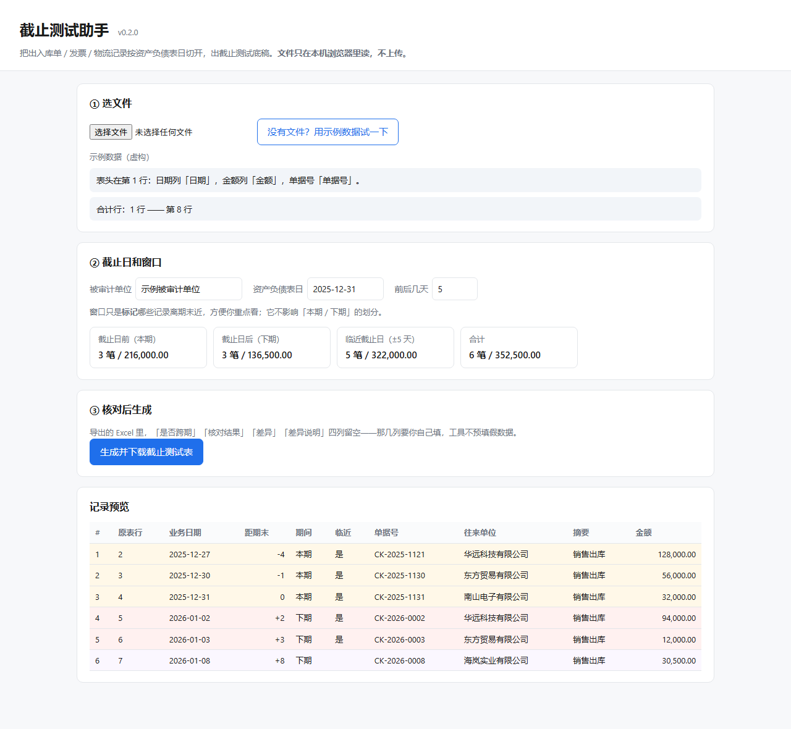

# 截止测试助手 v0.2.0

把出入库单 / 发票 / 物流记录按资产负债表日切开，出**截止测试底稿**。

单页 HTML，解压后双击 `index.html` 就能用。不用装、不用联网，**文件只在浏览器里读，不上传任何地方**。



**不想读文档？** [下载最新版 ZIP](../../releases/latest) → 解压 → 双击 index.html，就这样。仓库里也有 index.html，直接打开同样是完整功能。
---

## 它解决什么

截止测试要回答一个问题：**这笔收入（成本）记没记在对的期间**。

做法是从资产负债表日前后挑出若干天的出入库、发票、物流记录，逐笔追到账面，
看期末那几笔是不是真的发出去了、期后那几笔是不是提前确认了。

手工做的问题不是慢，是**挑不准、留不下痕迹**：

- 从几千行流水里挑「12 月最后五天」，靠翻和看，挑漏了没人知道
- 挑出来之后没有统一的底稿格式，回填核对结果时对着另一张表
- 复核的人问「你这几笔是怎么挑的」，答不出可复现的规则

这个工具把「切」这一步固定下来，并且**每一条记录都带原表行号**——底稿能追回原表。

---

## 怎么用

### 1. 传单据流水

需要一个**日期列**和一个**金额列**，其余列有就带出来，没有也能用：

| 列 | 认的名字 |
|---|---|
| 日期（必需） | 日期 / 业务日期 / 出库日期 / 开票日期 / 制单日期 / 时间 |
| 金额（必需） | 金额 / 价税合计 / 合计金额 / 总金额 |
| 单据号 | 单据号 / 单号 / 凭证号 / 发票号 / 出库单 / 入库单 / 编号 |
| 往来单位 | 客户 / 供应商 / 单位名称 / 往来单位 / 购货单位 / 销售单位 |
| 摘要 | 摘要 / 备注 / 说明 / 品名 / 货物名称 |

表头在前 30 行内都能找到。日期认 `2025-12-31`、`2025/1/5`、`2025.1.5`、`2025年1月5日`、`20250105` 和 Excel 的日期序列号。

> 没有文件可以先点「用示例数据试一下」，示例是虚构的。

### 2. 填截止日和窗口

- **资产负债表日**：通常是 12-31，也就是本期和下期的分界
- **前后几天**：只是**标记**哪些记录离期末近（底稿里标「临近期末」），不影响划分

划分规则很简单：**当天及以前 = 本期，之后 = 下期**。

### 3. 核对后生成

导出的 Excel 有 14 列，其中**四列故意留空**：

| 列 | 谁填 |
|---|---|
| 序号 / 原表行 / 业务日期 / 距期末 / 所属期间 / 临近期末 / 单据号 / 往来单位 / 摘要 / 金额 | 工具填 |
| **是否跨期** | 你填（这笔是不是记错了期间） |
| **核对结果** | 你填（追到账上了没有） |
| **差异** | 你填 |
| **差异说明** | 你填 |

留空是有意的：工具不知道你追账的结果，**不预填假数据**。

金额列是数值，合计行是公式（改明细会自动重算）。

---

## 它不做什么

- **不判断跨期**。工具只负责按日期切开；哪笔该调、该怎么调，是项目组的判断。
- **不做账账核对**。它不读账面数，也不做「单据 vs 账面」的自动匹配——那需要先知道账面怎么记。
- **不替代截止测试程序的设计**。抽哪几天、抽几笔，是审计方案定的。
- **不做存货监盘、不做计价测试**。

---

## 只认这一种表

**逐笔流水**：一行一笔业务，有日期、有金额。

**会拒绝的**（界面上会写清楚为什么）：

- **余额表**（有「余额 / 期初 / 期末」这类列、又没有单据号）——那是一个时点的余额，不是业务发生
- **没有日期列**——截止测试的全部意义就是按日期切，没有日期做不了
- **多列都像金额**（比如「不含税金额」和「价税合计」并列）——分不清用哪一列，宁可让你删掉一列
- 一行有效记录都读不出来

---

## 几个设计上的取舍

**金额一律按分算。** 内部用整数分，显示才转成元。

**读不出的行不丢。** 日期读不出、金额读不出的行，会带**原表行号**和原始内容列出来，
并说明「这几行没有算进截止测试」。悄悄跳过的结果是底稿少一笔，而没人知道。

**合计行不当业务。** 表里的「合计 / 小计 / 本页小计」会自动跳过，并记一条「跳过 N 行合计行」。

**`12,34` 这种不认。** 千分位只认每三位一组。猜错就是一笔钱的差错。

**负数保留。** 冲销的红字记录是负数，工具照原样保留，不会取绝对值。

---

## 文件说明

```
index.html      入口，双击打开
core.js         纯逻辑：认列、读行、分桶、出表（可在 node 里单独测）
app.js          界面
app.css         样式
vendor/         SheetJS（离线，读 xlsx）
test/           回归测试
```

跑测试：

```powershell
powershell -NoProfile -ExecutionPolicy Bypass -File test\run-all.ps1
```

打发布包：

```powershell
powershell -NoProfile -ExecutionPolicy Bypass -File test\pack.ps1
```

---

## 测试覆盖

| 套件 | 断言 | 覆盖 |
|---|---|---|
| core | 77 | 金额、日期、认列、读行、分桶、汇总、控制表、文件名 |
| fixes | 122 | 表头位置、日期写法、金额写法、合计行、边界日、窗口、排序、无单据号、冲销 |
| limits | 32 | 空表、只有表头、垃圾表、日期全读不出、表头太远、超长名称、列序打乱 |
| export | 50 | 装进 xlsx 再读回来：金额是数值、留空列无假数据、序号连续、合计公式 |
| ui-smoke | 67 | 假 DOM 跑真 app.js：读文件 → 改参数 → 生成 |

---

## 数据安全

所有处理都在你自己的浏览器里完成。没有后端，没有埋点，没有上传。

**但请注意**：导出的底稿里有客户名称和金额。这些文件按你所在单位的保密要求管理。

---

## 已知限制

- **金额单位只认元。** 万元表请先乘 10000 再导入。
- **一次处理一个文件的一张表。** 多张可用表时按读出的记录数自动挑，不提供下拉切换。
- **日期格式有限**。`1/5/2025` 这种美式写法不认——中英文环境不同，猜错就是几天的事。
- **不做账面匹配**。「单据 ↔ 账面凭证」的匹配要自己做。

---

## 版本

v0.2.0

## 许可

MIT

---

更多离线小工具（审计、文档、系统）见 [awesome-lee2277](https://github.com/Lee2277-t/awesome-lee2277)。
